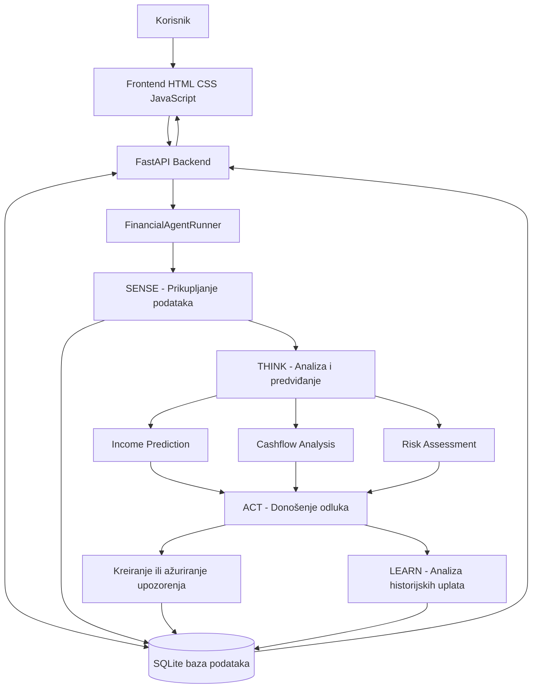

# PERSONAL FINANCE AGENT
## Agent za predviđanje likvidnosti kod korisnika s neredovnim prihodima

**Predmet:** Umjetna inteligencija  
**Student:** Harun Šemić  
**Fakultet:** Fakultet informacijskih tehnologija, Univerzitet „Džemal Bijedić“ u Mostaru  
**Programski jezik:** Python  
**Baza podataka:** SQLite  
**Verzija projekta:** 1.0

---

# 1. Uvod

Upravljanje ličnim finansijama predstavlja izazov za osobe koje nemaju redovne i predvidljive prihode. Za razliku od zaposlenih osoba koje primaju platu na unaprijed poznat datum, osobe s neredovnim prihodima često ne mogu sa sigurnošću znati kada će novac biti dostupan.

Problem nastaje kada se očekivani prihod ne realizuje na planirani datum, dok obaveze poput stanarine, računa, kredita i drugih troškova imaju unaprijed definisane rokove plaćanja.

Cilj ovog projekta je razvoj inteligentnog softverskog agenta koji analizira finansijsko stanje korisnika, predviđa datume budućih uplata na osnovu prethodnih kašnjenja, simulira budući novčani tok i pravovremeno upozorava korisnika na potencijalni nedostatak sredstava.

Agent ne služi samo za evidentiranje prihoda i obaveza, već koristi historijske podatke kako bi prilagođavao svoja buduća predviđanja.

# 2. Definicija problema

Osnovni problem koji sistem rješava jeste određivanje da li će korisnik imati dovoljno novca da izmiri sve dospjele obaveze prije nego što očekivani prihod postane dostupan.

Sistem uzima u obzir sljedeće podatke:

- Trenutno stanje novca na računu.
- Očekivane prihode i njihove planirane datume.
- Stvarne datume i iznose realizovanih uplata.
- Izvor svakog prihoda.
- Finansijske obaveze i njihove rokove dospijeća.
- Historijska kašnjenja uplata za pojedinačne izvore prihoda.

Poseban značaj ima razlikovanje očekivanog i stvarnog datuma uplate. Na osnovu te razlike agent može prepoznati obrasce kašnjenja i koristiti ih za poboljšanje budućih predviđanja.

# 3. Ciljevi projekta

Glavni cilj je implementacija autonomnog finansijskog agenta koji može:

1. Prikupiti podatke o trenutnom finansijskom stanju.
2. Analizirati očekivane prihode i neizmirene obaveze.
3. Predvidjeti datume budućih uplata na osnovu historijskih podataka.
4. Simulirati budući novčani tok hronološkim redoslijedom.
5. Identifikovati datum i iznos potencijalnog nedostatka novca.
6. Procijeniti nivo finansijskog rizika.
7. Samostalno kreirati ili ažurirati upozorenja.
8. Učiti iz stvarnih datuma prethodnih uplata i prilagođavati buduća predviđanja.

Sistem je namijenjen jednom korisniku i koristi KM kao valutu.

# 4. Arhitektura sistema

Sistem je razvijen korištenjem Python programskog jezika i FastAPI okvira. Podaci se čuvaju u SQLite bazi podataka, dok se korisnički interfejs realizuje korištenjem HTML-a, CSS-a i JavaScripta.

Arhitektura je podijeljena na nekoliko logičkih cjelina:

- **Korisnički interfejs:** omogućava unos prihoda, obaveza i pregled finansijskog stanja.
- **API sloj:** prima zahtjeve korisničkog interfejsa i povezuje ga s poslovnom logikom.
- **Agent:** koordinira prikupljanje podataka, analizu, donošenje odluka i učenje.
- **Servisi za obradu podataka:** obrađuju predviđanje prihoda, novčani tok i odluke.
- **Baza podataka:** čuva finansijske podatke i historiju upozorenja.

## 4.1. Dijagram arhitekture

# 5. Arhitektura inteligentnog agenta

Centralna komponenta sistema je klasa `FinancialAgentRunner`, koja koordinira izvršavanje četiri osnovne faze:

**Sense → Think → Act → Learn**

Svaki ciklus izvršavanja predstavlja jednu analizu finansijskog stanja korisnika.

## 5.1. SENSE – Prikupljanje podataka

U ovoj fazi agent prikuplja podatke iz baze:

- Trenutno stanje računa.
- Očekivane prihode.
- Prihode koji su evidentirani kao primljeni, ali čiji datum realizacije još nije nastupio.
- Neizmirene finansijske obaveze.

Prikupljeni podaci predstavljaju osnovu za narednu fazu.

Implementacija se nalazi u metodi `sense()` klase `FinancialAgentRunner`.

## 5.2. THINK – Analiza i predviđanje

U ovoj fazi agent obrađuje prikupljene podatke i procjenjuje buduće finansijsko stanje.

THINK faza obuhvata tri ključna procesa.

### 5.2.1. Predviđanje datuma prihoda

Za svaki očekivani prihod agent pronalazi prethodne realizovane uplate koje pripadaju istom izvoru prihoda.

Kašnjenje pojedinačne uplate računa se formulom:

**Kašnjenje = Stvarni datum uplate − Očekivani datum uplate**

Na osnovu historijskih kašnjenja izračunava se prosječno kašnjenje:

\[
D_{avg}=\frac{1}{n}\sum_{i=1}^{n}D_i
\]

Predviđeno kašnjenje za buduću uplatu određuje se zaokruživanjem prosječnog kašnjenja na veći cijeli broj i ograničavanjem minimalne vrijednosti na nulu:

\[
D_{pred}=\lceil\max(0,D_{avg})\rceil
\]

Predviđeni datum uplate:

\[
Datum_{pred}=Datum_{očekivani}+D_{pred}
\]

Ako ne postoje historijski podaci za određeni izvor prihoda, agent koristi očekivani datum uplate.

Predviđanje je implementirano u modulu `income_prediction.py`.

### 5.2.2. Analiza novčanog toka

Nakon predviđanja datuma prihoda agent simulira buduće finansijsko stanje.

U simulaciju uključuje:

- Predviđene datume budućih prihoda.
- Prihode koji su već evidentirani s budućim datumom realizacije.
- Datume dospijeća neizmirenih obaveza.

Događaji se sortiraju hronološki. Ako prihod i obaveza imaju isti datum, obaveza se obrađuje prva, što predstavlja konzervativan pristup.

Za svaki događaj izračunava se novo stanje:

\[
B_{novo}=B_{prethodno}+I-O
\]

Gdje su:

- \(B\) – stanje novca.
- \(I\) – iznos prihoda.
- \(O\) – iznos obaveze.

Ako stanje postane negativno, agent evidentira potencijalni nedostatak novca.

Sistem određuje prvi datum nastanka manjka i najveći predviđeni iznos manjka.

Implementacija se nalazi u modulu `cashflow_service.py`.

### 5.2.3. Procjena rizika

Na osnovu datuma nastanka manjka i njegovog iznosa agent određuje nivo finansijskog rizika.

Sistem koristi tri nivoa:

- **LOW:** nizak nivo rizika.
- **MEDIUM:** srednji nivo rizika.
- **HIGH:** visok nivo rizika.

Procjena se zasniva na vremenu preostalom do predviđenog manjka i iznosu nedostajućih sredstava.

Trenutna pravila uključuju:

- Visok rizik ako je manjak za tri ili manje dana ili ako maksimalni manjak iznosi najmanje 1.000 KM.
- Srednji rizik ako je manjak za sedam ili manje dana ili ako prvi manjak iznosi najmanje 300 KM.
- U ostalim slučajevima rizik je nizak.

Implementacija se nalazi u modulu `decisions.py`.

## 5.3. ACT – Donošenje odluka

Nakon analize agent donosi odluku o potrebi kreiranja upozorenja.

Ako simulacija ne predviđa nedostatak novca, agent deaktivira postojeća aktivna upozorenja.

Ako je predviđen nedostatak novca, agent:

1. Identifikuje datum prvog manjka.
2. Određuje iznos nedostajućih sredstava.
3. Identifikuje obavezu povezanu s nastankom manjka.
4. Procjenjuje nivo rizika.
5. Izračunava indeks pouzdanosti predviđanja.
6. Kreira novo upozorenje ili ažurira postojeće aktivno upozorenje.

Na ovaj način agent izbjegava nepotrebno kreiranje više aktivnih upozorenja za isti datum manjka.

Indeks pouzdanosti predstavlja heurističku procjenu zasnovanu na količini dostupnih historijskih podataka. Ne predstavlja statistički kalibrisanu vjerovatnoću.

Implementacija se nalazi u modulu `decisions.py`.

## 5.4. LEARN – Učenje iz historijskih podataka

U ovoj fazi agent analizira realizovane prihode i njihova kašnjenja.

Podaci se grupišu prema izvoru prihoda, tako da se kašnjenja jednog izvora ne koriste za predviđanje drugog izvora.

Nakon evidentiranja nove realizovane uplate, historijski skup podataka se proširuje.

Pri narednom izvršavanju agent koristi ažuriranu historiju i ponovo izračunava prosječno kašnjenje.

Važno je naglasiti da trenutna implementacija koristi adaptivno statističko učenje zasnovano na historijskim podacima. Ne koristi trenirani model mašinskog učenja.

# 6. Model podataka

Sistem koristi sljedeće osnovne entitete.

## 6.1. IncomePayment

Predstavlja očekivanu ili realizovanu uplatu.

Najvažnija polja:

- `id` – jedinstveni identifikator.
- `source_name` – naziv izvora prihoda.
- `expected_date` – očekivani datum uplate.
- `expected_amount` – očekivani iznos.
- `actual_date` – stvarni datum uplate.
- `actual_amount` – stvarni iznos.
- `status` – status uplate.

Statusi omogućavaju razlikovanje očekivanih, planiranih budućih i realizovanih uplata.

## 6.2. Obligation

Predstavlja finansijsku obavezu korisnika.

Polja:

- `id` – identifikator.
- `title` – naziv obaveze.
- `amount` – iznos obaveze.
- `due_date` – datum dospijeća.
- `paid_date` – datum plaćanja.
- `status` – status obaveze.

## 6.3. AccountState

Čuva trenutno stanje novca na računu.

Polja:

- `id`
- `current_balance`
- `updated_at`

## 6.4. AgentAlert

Čuva upozorenja koja agent generiše.

Polja:

- `id`
- `created_at`
- `shortage_date`
- `shortage_amount`
- `message`
- `confidence`
- `is_active`

# 7. Demonstracija adaptivnog učenja

Jedan od najvažnijih zahtjeva projekta jeste demonstracija da agent mijenja svoje ponašanje nakon što dobije nove historijske podatke.

Za tu svrhu implementiran je poseban modul `learning_demo.py`.

Demonstracija koristi izolovanu SQLite bazu kako bi se osiguralo da testni podaci ne mijenjaju glavnu bazu aplikacije.

## 7.1. Početni scenario

Pretpostavimo sljedeće stanje:

- Početno stanje računa: 1.000 KM.
- Očekivana plata: 1.500 KM.
- Očekivani datum plate: 20.11.2026.
- Obaveza: 1.200 KM.
- Datum dospijeća obaveze: 21.11.2026.

U početnom scenariju agent nema historijske podatke o kašnjenju plate.

Zbog toga koristi očekivani datum uplate – 20.11.2026.

Plata stiže prije dospijeća obaveze, pa simulacija ne predviđa nedostatak novca.

## 7.2. Učenje iz novih podataka

Nakon početne analize u bazu se dodaju tri prethodne realizovane uplate plate, od kojih je svaka kasnila tri dana.

Agent sada ima podatke na osnovu kojih može prepoznati obrazac kašnjenja.

Prosječno historijsko kašnjenje iznosi tri dana.

Zbog toga se očekivani datum buduće plate pomjera sa 20.11.2026. na 23.11.2026.

## 7.3. Rezultat nakon učenja

Nakon prilagođavanja predviđanja, plata više ne stiže prije dospijeća obaveze.

Na dan 21.11.2026. korisnik ima 1.000 KM, dok obaveza iznosi 1.200 KM.

Agent prepoznaje nedostatak od 200 KM i samostalno kreira upozorenje.

## 7.4. Poređenje rezultata

| Parametar | Prije učenja | Nakon učenja |
|---|---:|---:|
| Početno stanje | 1.000 KM | 1.000 KM |
| Očekivani prihod | 1.500 KM | 1.500 KM |
| Očekivani datum plate | 20.11.2026. | 20.11.2026. |
| Historijsko kašnjenje | Nema podataka | 3 dana |
| Predviđeni datum plate | 20.11.2026. | 23.11.2026. |
| Datum dospijeća obaveze | 21.11.2026. | 21.11.2026. |
| Predviđeni manjak | Ne | Da |
| Iznos manjka | 0 KM | 200 KM |
| Upozorenje | Nije kreirano | Kreirano |

Ova demonstracija pokazuje da agent ne koristi samo unaprijed definisane datume, već prilagođava svoja predviđanja na osnovu novih podataka.

# 8. Korisnički interfejs

Frontend aplikacije omogućava korisniku jednostavno upravljanje finansijskim podacima.

Osnovne funkcionalnosti interfejsa:

- Pregled trenutnog stanja računa.
- Pregled očekivanih prihoda.
- Pregled finansijskih obaveza.
- Unos novih očekivanih prihoda.
- Unos novih finansijskih obaveza.
- Evidentiranje stvarno primljenih uplata.
- Pregled predviđenog novčanog toka.
- Pregled upozorenja koje generiše agent.
- Ručno pokretanje analize agenta.

Backend se s frontend aplikacijom povezuje putem REST API-ja implementiranog korištenjem FastAPI okvira.

# 9. Automatsko izvršavanje agenta

Agent se ne mora pokretati isključivo ručno.

Prilikom pokretanja FastAPI aplikacije aktivira se pozadinski proces koji izvršava analizu finansijskog stanja, a zatim čeka 24 sata do naredne redovne provjere.

Pored redovnog izvršavanja, agent se može pokrenuti i nakon relevantnih promjena finansijskih podataka.

Na taj način sistem može reagovati na nove prihode, obaveze i realizovane uplate.

# 10. Testiranje sistema

Za provjeru ispravnosti implementacije korišten je Pytest.

Testovi obuhvataju:

- Analizu novčanog toka.
- Obradu prihoda i obaveza koje imaju isti datum.
- Prepoznavanje privremenog nedostatka novca.
- Predviđanje datuma prihoda bez historijskih podataka.
- Predviđanje na osnovu historijskih kašnjenja.
- Razdvajanje izvora prihoda.
- Prilagođavanje predviđanja nakon novih uplata.
- Kreiranje, ažuriranje i deaktivaciju upozorenja.
- Procjenu nivoa rizika.
- Funkcionalnost centralnog agenta.
- REST API funkcionalnosti.
- Obradu budućih i realizovanih uplata.

Posljednje izvršavanje testova pokazalo je:

**27 uspješno izvršenih testova.**

Jedno upozorenje koje se pojavljuje odnosi se na depreciranu integraciju `httpx` biblioteke s testnim klijentom i ne predstavlja neuspjeh testa.

# 11. Ograničenja sistema

Trenutna implementacija ima nekoliko ograničenja:

1. Predviđanje datuma prihoda zasniva se na historijskom prosječnom kašnjenju.
2. Za nove izvore prihoda bez historijskih podataka koristi se očekivani datum.
3. Sistem ne koristi trenirani model mašinskog učenja.
4. Procjena pouzdanosti je heuristička, a ne kalibrisana statistička vjerovatnoća.
5. Sistem ne povezuje stvarne bankovne račune.
6. Upozorenja imaju informativni karakter i ne izvršavaju automatska plaćanja.
7. Kvalitet predviđanja zavisi od tačnosti i količine unesenih podataka.

# 12. Moguća buduća unapređenja

Moguća unapređenja sistema uključuju:

- Korištenje medijane i drugih statističkih mjera za robusnije predviđanje kašnjenja.
- Analizu promjene obrazaca kašnjenja kroz vrijeme.
- Naprednije modele mašinskog učenja kada bude dostupno dovoljno podataka.
- Detaljniju procjenu trajanja finansijskog manjka.
- Podršku za više korisnika.
- Integraciju sa bankovnim servisima.
- Naprednije izvještaje i vizualizacije novčanog toka.

Navedene funkcionalnosti predstavljaju mogućnosti budućeg razvoja i nisu dio trenutne implementacije.

# 13. Zaključak

U okviru projekta razvijen je Personal Finance Agent, inteligentni sistem namijenjen predviđanju likvidnosti kod korisnika s neredovnim prihodima.

Sistem objedinjuje prikupljanje finansijskih podataka, statističko predviđanje datuma uplata, simulaciju budućeg novčanog toka, procjenu rizika i autonomno generisanje upozorenja.

Posebna vrijednost projekta ogleda se u adaptivnom ponašanju agenta. Na osnovu historijskih kašnjenja uplata agent prilagođava buduće datume prihoda i može prepoznati finansijski problem koji ne bi bio vidljiv kada bi se koristili isključivo prvobitno očekivani datumi.

Implementirani demonstracijski scenario potvrđuje da se odluka agenta mijenja nakon dodavanja novih historijskih podataka, pri čemu se upozorenje kreira kada predviđeni datum prihoda više ne omogućava pravovremeno izmirenje obaveze.

Projekt pokazuje praktičnu primjenu koncepta inteligentnog agenta kroz ciklus Sense–Think–Act–Learn i predstavlja osnovu za budući razvoj naprednijeg sistema za predviđanje lične finansijske likvidnosti.